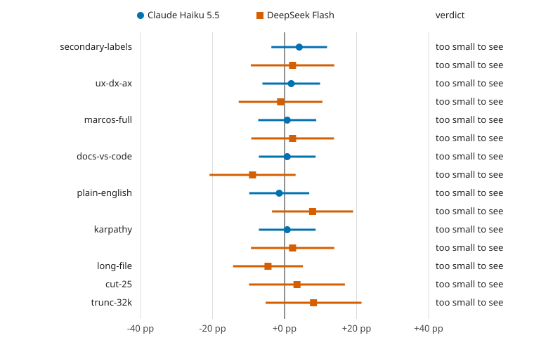

# harness-diff

I took nine of the most-shared AGENTS.md lines on X and tested each one the way you'd test a drug: same 30 coding
tasks, same agent, with and without the line, many runs each, the plan written down and pushed before the first run.
None of them changed how often the agent finished the task by more than rerunning the agent does. The run could
have seen a line that hurt by 12 to 17 points. It saw none.

The control that compares the baseline to itself, with nothing changed, read **+6.7 points** on DeepSeek. That's
how big pure noise is at this size, and it's bigger than most of the effects below.



| Line | Source | Haiku 5.5 | DeepSeek Flash | Verdict |
|---|---|---|---|---|
| "Avoid unnecessary secondary labels" | [@luinlee](https://x.com/luinlee/status/2113085361836744764), 7.7K likes | +4.1 [-3.7, +11.8] | +2.2 [-9.4, +13.8] | too small to see |
| "Elevate UX, DX and AX" | [@Voxyz_ai](https://x.com/Voxyz_ai/status/2113254050170843418), 7.1K | +1.9 [-6.1, +9.8] | -1.1 [-12.7, +10.5] | too small to see |
| "My full AGENTS.md after ~60B tokens" | [@MarcosHernanz](https://x.com/MarcosHernanz/status/2083954734487212511), 10.8K | +0.7 [-7.3, +8.8] | +2.2 [-9.3, +13.7] | too small to see |
| "When docs and code disagree, follow the code" | [@ai_database](https://x.com/ai_database/status/2114184481951330365), 6.3K | +0.7 [-7.1, +8.6] | -8.9 [-20.8, +3.1] | too small to see |
| "Plain English, no agent slang" | [@drummatick](https://x.com/drummatick/status/2115102978848022571), 2.4K | -1.5 [-9.8, +6.9] | +7.8 [-3.5, +19.0] | too small to see |
| Karpathy-style CLAUDE.md | [@Saccc_c](https://x.com/Saccc_c/status/2058467100537090544), 2.3K | +0.7 [-7.1, +8.6] | +2.2 [-9.3, +13.8] | too small to see |
| A real 52 KB AGENTS.md vs none | [@hartshorne](https://x.com/hartshorne/status/2117848891303612427) | | -4.6 [-14.3, +5.1] | too small to see |
| Cut 25% of that file | same | | +3.4 [-9.9, +16.8] | too small to see |
| Cut it at 32 KiB, as Codex does | same | | +8.0 [-5.3, +21.4] | too small to see |
| *Placebo: baseline vs itself* | | -2.2 [-11.0, +6.5] | +6.7 [-3.8, +17.1] | too small to see |

Effects are percentage points of pass rate, line minus no line, averaged over tasks. Intervals are simultaneous 95%
across each model's rows. The baseline passes 95.9% on Haiku and 84.4% on DeepSeek. Exact texts and sources are in
[LINES.md](LINES.md).

## What the run could see

Each model got three full rounds before its spending cap: 900 counted runs on Haiku, 1,260 on DeepSeek, $2.97 at list
price in all. At that size:

- **Haiku** passes 95.9% of these tasks with no AGENTS.md, so there's no room to see a line help. A line that hurt
  by 12 points or more would have shown up.
- **DeepSeek Flash** would have shown a short line that helped by 13 points or hurt by 16, and a long-file change
  of about 10 to 17 points either way.

So "too small to see" means smaller than that, not zero. Claims like "evals improved after we cut 25%" can be true
and still sit well inside this noise.

## What did change

The lines changed behaviour even where they didn't change outcomes:

- "When docs and code disagree" made Haiku spend **0.62 more turns per task** [+0.56, +0.67] and DeepSeek 0.22 more
  [+0.17, +0.26]. The placebo moved turns by 0.00.
- A rule placed at the very end of the 52 KB file was followed **89%** of the time, against **100%** when it was the
  only rule: -10.6 points [-19.6, -1.5]. This is the one effect the run could see. Burying a rule under 52 KB of
  other rules costs you something. Cutting a quarter of the file didn't get it back (-6.7 [-17.3, +3.8]).
- The same rule on its own took compliance from 0% to 96.6% on Haiku and 100% on DeepSeek, which shows the setup
  catches an effect when there is one.

## Run it on your own AGENTS.md

```sh
git clone https://github.com/abhaymettu/harness-diff && cd harness-diff
python3 -m harness_diff.cli diff OLD_AGENTS.md NEW_AGENTS.md --model haiku --plan   # what it could detect, and the cost
python3 -m harness_diff.cli diff OLD_AGENTS.md NEW_AGENTS.md --model haiku --n 10   # run it
```

Use `/dev/null` for "no AGENTS.md". `--plan` prints the smallest help and hurt the run could see before you spend
anything: at `--n 10` on Haiku that's about +4.5 and -5.7 points, for 600 runs and about $0.84 at list price. Claude
models run through `claude -p` with its tools and your settings switched off. Any OpenAI-compatible model works with
`HARNESS_DIFF_API_KEY` and `HARNESS_DIFF_BASE_URL` set. Runs resume where they stopped, and every run leaves a
receipt with the model's full transcript and usage.

Python 3.10 or newer, no dependencies. macOS only for now: the agent's code runs under `sandbox-exec` with Homebrew's
`/opt/homebrew/bin/python3`.

## How it works

- **Tasks.** 30 small Python tasks with deterministic checks (fix a bug, write a module, compute a file, do a
  multi-file chore), borrowed byte for byte from [reliability-weather](https://github.com/abhaymettu/reliability-weather),
  which froze them before these lines were picked. The agent gets 4 turns. No model grades anything.
- **The line goes where agents put it.** The AGENTS.md text goes ahead of the task in the first message, the way
  coding agents pass instruction files. Nothing else differs between arms.
- **Paired by task.** Every arm runs every task, and each comparison is made task by task, so hard and easy tasks
  cancel out. The shared baseline runs three times as often as each line.
- **Planned before running.** [PREREGISTRATION.md](PREREGISTRATION.md) was pushed before the first counted run
  (commit 861e6d3). It fixes the rows, the statistic, the interval, the verdict rule and the power analysis. An
  independent reviewer read it first and caught a bias, which was fixed before the freeze (section 11).
- **Why the noise is the point.** In [agent-run-reliability](https://github.com/abhaymettu/agent-run-reliability),
  half of the pass/fail variance across 384 Claude Code runs was run to run. A single before-and-after comparison
  mostly measures that.

## Limits

- The tasks are short Python tasks with a tight turn budget. A line about UI, prose or long projects has nothing to
  act on here, so these rows test what such a line costs when it doesn't apply, not whether it works where it does.
- Two cheap models. Sonnet passes 97.9% of these tasks, which leaves nothing to detect.
- The long file is pydantic-ai's AGENTS.md pair, not Instant's, whose cut isn't public. The 25% cut is random.
- The Karpathy-style file has no license, so it's fetched at a pinned commit by `scripts/build_arms.py`, not stored.

## Reproduce

```sh
python3 scripts/build_arms.py                                  # arm texts, checked against their sha256 pins
python3 -m unittest discover -s tests -t .                     # 15 tests
python3 -m harness_diff.cli report experiments/2026-11-04.json # the table above, from the receipts in runs/
```
